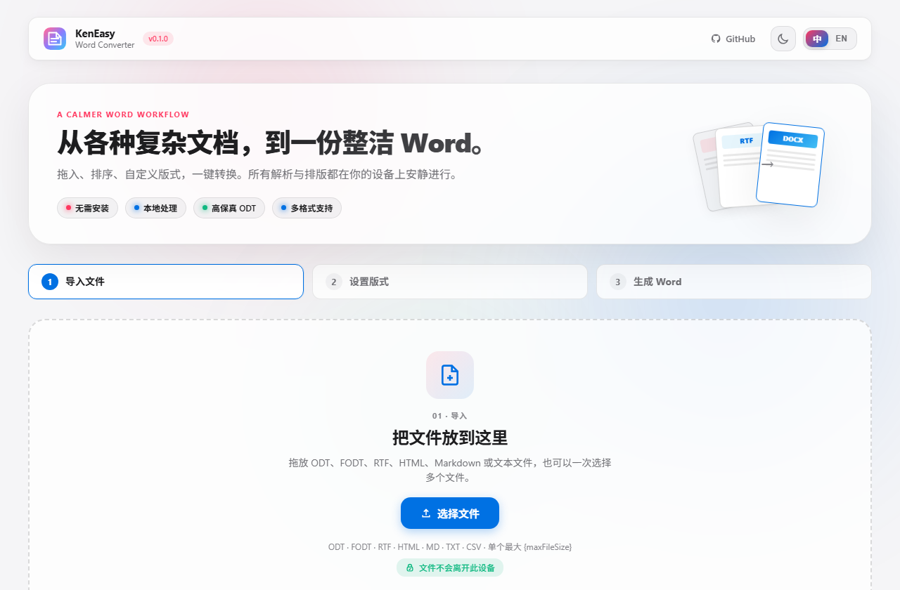
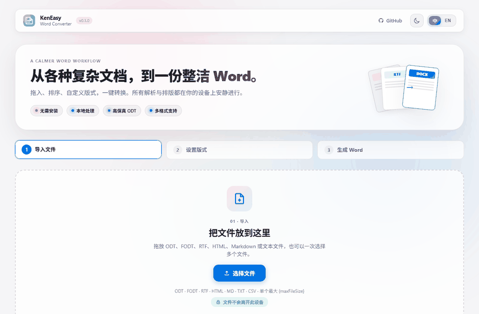
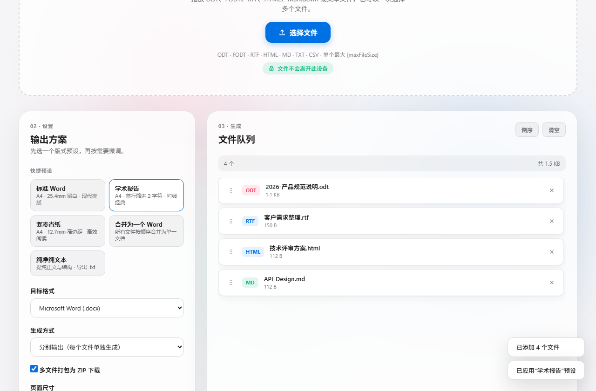
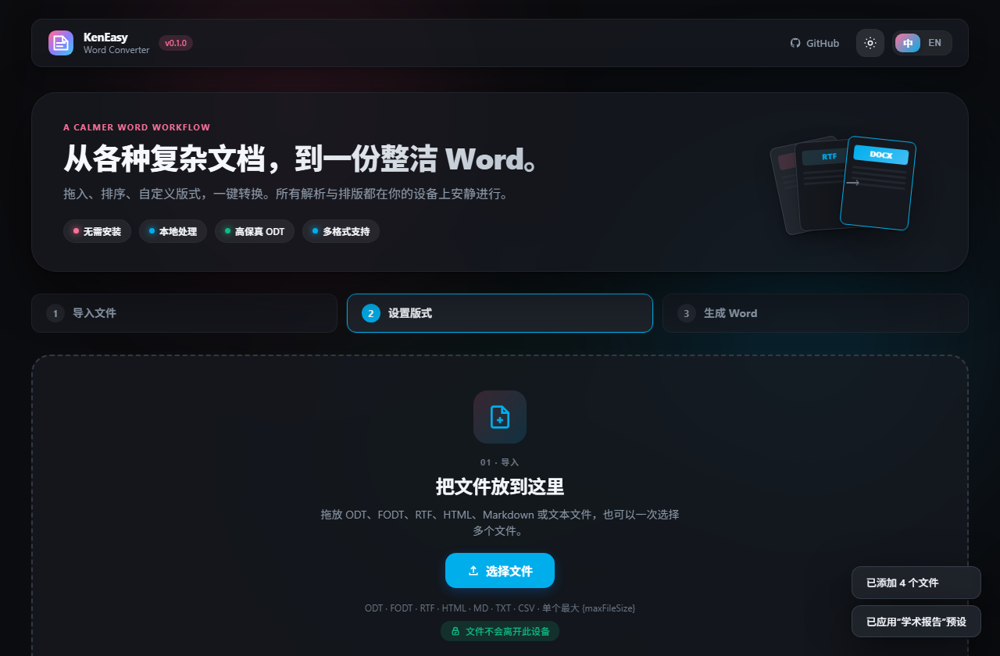
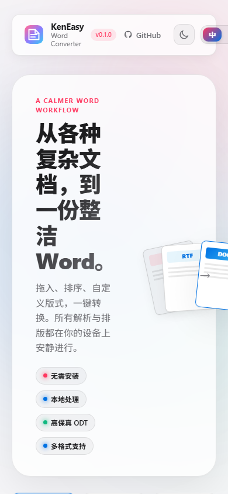

<div align="center">

# KenEasy Word Converter

**Instant, Private ODT & Universal Document to Word Converter** — Seamlessly convert `.odt`, `.fodt`, `.rtf`, `.html`, Markdown, and `.txt` to Microsoft Word (`.docx`) or plain text (`.txt`).
100% processed locally in your browser. **Zero uploads, no software installation, no sign-up, absolute privacy**.

<br/>

### 👉 Click Here to Launch the App

# [🚀 Open Word Converter (Online)](https://ngiken.github.io/KenEasy-word/)

**https://ngiken.github.io/KenEasy-word/**

> The link above is the **live web application**.
> This GitHub page is the **source code repository**.

<br/>

[中文](README.md) · [English](README.en.md)

<br/>


<br/><br/>



<sub>Apple-inspired adaptive glassmorphic UI · Works offline out of the box</sub>

</div>

---

## 30-Second Quickstart

1. Open: **[Online Web App](https://ngiken.github.io/KenEasy-word/)**
2. Drag & drop `.odt`, `.fodt`, `.rtf`, `.html`, `.md`, or `.txt` documents (batch multi-file supported)
3. Choose a preset (Standard, Academic with 2-char indent, Compact, Merge All, Plain Text) or customize page margins and fonts
4. Reorder documents with the `⠿` handle (or keyboard ↑ / ↓)
5. Click **Convert Documents** → Download native `.docx` or bundled `.zip` in seconds

No accounts, no waiting queues, no cloud leak risks.

### Quick Tour

<p align="center">
  
</p>

<p align="center"><strong>① Import documents　→　② Customize layout & order　→　③ Generate Word locally</strong></p>

---

## What Is This?

In daily office workflows, we frequently encounter OpenDocument files (`.odt`), legacy RTF reports, offline web HTMLs, or developer Markdown docs. Many online converters require uploading sensitive confidential contracts and resumes to third-party cloud servers.

**KenEasy Word Converter** is a **pure client-side, 100% offline-capable** high-fidelity document converter:

| What you want to do | How KenEasy helps |
| --- | --- |
| **Convert ODT / FODT to Word** | Parses OpenDocument XML trees, preserving headings, bold/italic, font colors, nested lists, tables, and **embedded media images** to standard ECMA-376 OpenXML `.docx` |
| **Convert RTF to Word** | Built-in state-machine tokenizer decoding character sets, text alignments, and formatting |
| **Convert HTML to Word** | Cleans DOM elements, translating `<h1>`-`<h6>`, paragraphs, blockquotes, tables, and hyperlinks into native Word styles |
| **Convert Markdown to Word** | Client-side lexer supporting headings, tables, code blocks, and task lists into polished Word layouts |
| **Batch Merge Documents** | Merge multiple diverse documents (e.g. ODT + RTF + MD) into a single unified Word document with clean page breaks |
| **Plain Text Extraction** | Strip out formatting and instantly extract clean `.txt` |
| **Air-gapped & Privacy-Critical Environments** | Protected by strict CSP `connect-src 'none'`. Fully operational even when disconnected from the Internet |

Supports **English / Chinese** and **Light / Dark** Apple-inspired adaptive aesthetics. Remembers your preferences and automatically respects system defaults.

---

## Screenshots

| Light Workspace | Dark Workspace |
| --- | --- |
|  |  |

<p align="center">
  
</p>

<p align="center"><sub>Dual-pane desktop workspace, touch-friendly responsive mobile layout.</sub></p>

---

## Supported Formats

| Format | Details | Fidelity Features |
| --- | --- | --- |
| **`.odt`** | OpenDocument Text (LibreOffice / OpenOffice) | Heading levels, bold/italic/underline, colors, ordered/unordered lists, tables, embedded images |
| **`.fodt`** | Flat XML OpenDocument | Single-file XML text parsed identically to ODT |
| **`.rtf`** | Rich Text Format | Font styles, paragraph alignments, multibyte Unicode |
| **`.html` / `.htm`** | Web pages & offline documents | Tag sanitization, headings, tables, links, blockquotes |
| **`.md` / `.markdown`** | Markdown text | ATX headers, emphasis, GFM tables, list indentation |
| **`.txt` / `.text`** | Plain text & logs | Heading detection, clean paragraph spacing |

---

## Presets & Configuration

- **Standard**: Tailored for business & general documentation. A4 paper, 2.54cm normal margins, modern sans-serif fonts.
- **Academic**: Classic serif typography (Songti / Times New Roman) with 2-character paragraph indentation.
- **Compact**: 1.27cm narrow margins maximizing page real-estate for tables and dense text.
- **Merge (One Docx)**: Stitches all queued files into one document separated by page breaks.
- **Plain Text**: Extracts text content to `.txt`.

---

## Technical Architecture

```text
web/
  index.html       # Semantic HTML skeleton with strict CSP connect-src 'none'
  styles.css       # Responsive glassmorphic design system with light/dark tokens
  config.js        # Data layer: limits, page sizes, typography, presets
  i18n.js          # Bilingual localization engine
  doc-engine.js    # Core domain: ODT/FODT/RTF/HTML/MD parsers & OpenXML generator
  app.js           # UI state, drag-and-drop queue, workflow pipeline
  vendor/          # Pinned offline JSZip and SortableJS
```

---

## Local Development & Testing

Run the full end-to-end test suite (32 automated checks verifying real DOM, downloads, OpenXML document structure, and conversions):

```bash
node scratch/e2e/run.mjs
```

Serve the web app locally:

```bash
python -m http.server 5173 --directory web
```

Open `http://localhost:5173/` in any browser.

---

## License

Licensed under the [MIT License](LICENSE).
